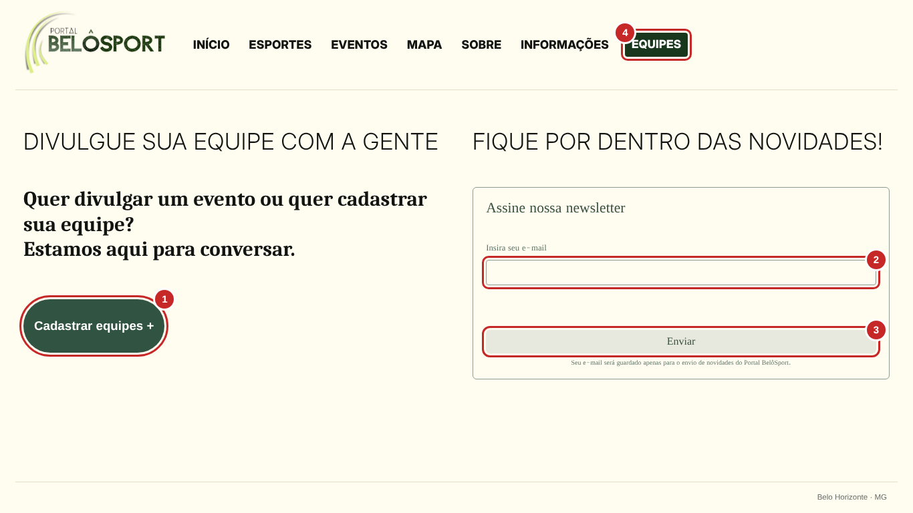
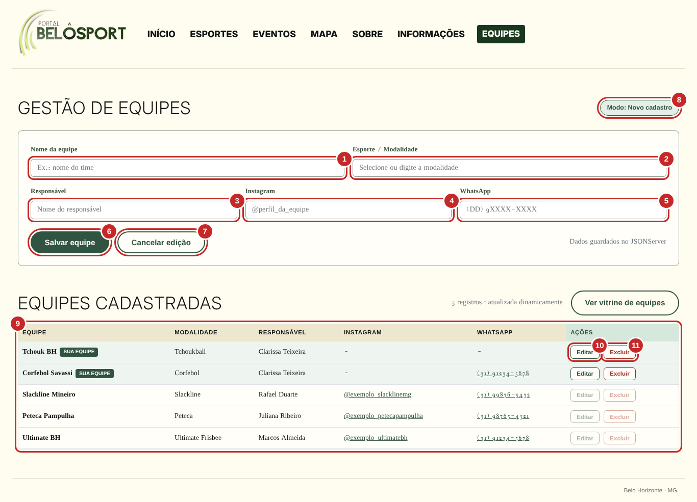
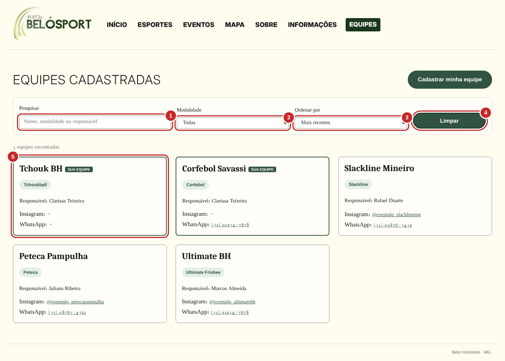
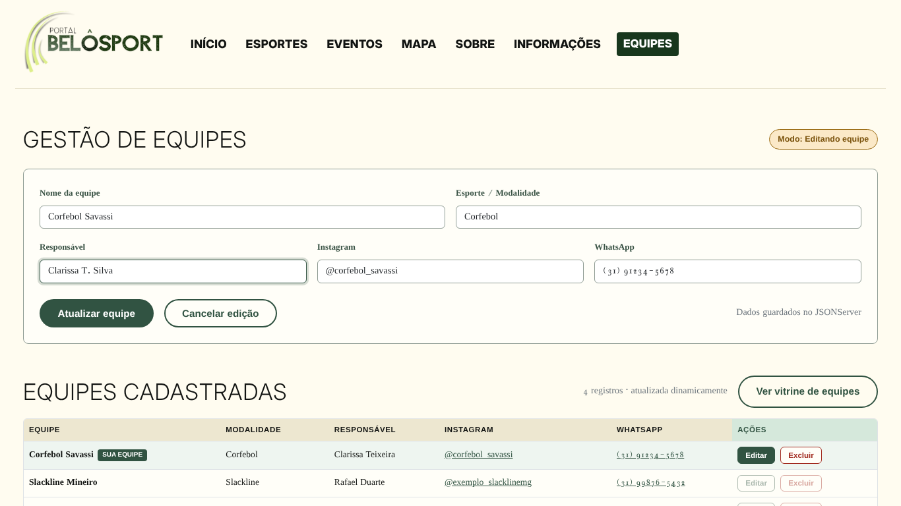
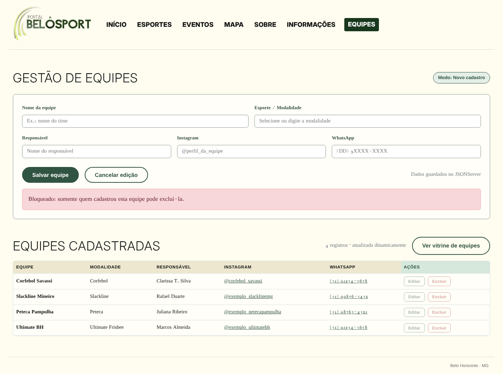
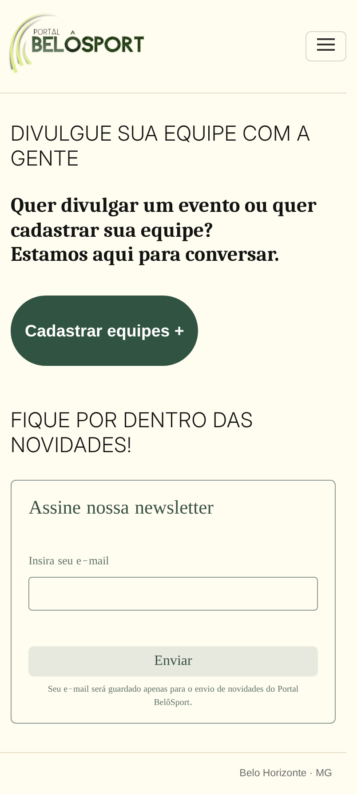
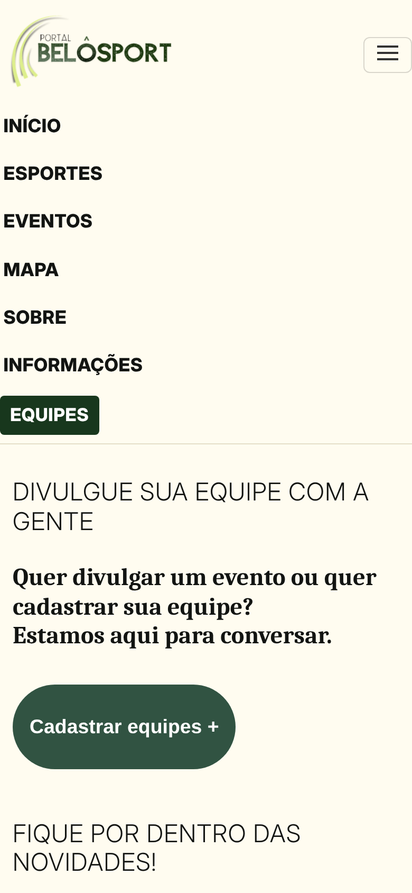
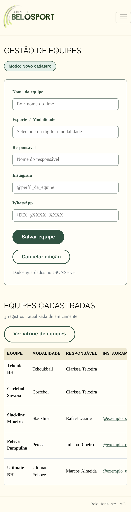

# Portal BelôSport – Cadastro e Interface das Equipes

Projeto do Trabalho Interdisciplinar – Aplicações Web (PUC Minas), Sprint 1.
**Equipe:** BelôSport (T1-03) · **Aluna:** Clarissa Teixeira da Silva · **Requisito 6:** Cadastro e Interface das Equipes (CI – CRUD)

O BelôSport é uma plataforma web para divulgar modalidades esportivas não convencionais em Belo Horizonte. Esta entrega permite que equipes amadoras **cadastrem, visualizem, editem e excluam** seus dados, com armazenamento permanente no **JSONServer**.

## Funcionalidades

| Página | Arquivo | O que faz |
|---|---|---|
| Equipes (inicial) | `html/equipes.html` | Botão **Cadastrar equipes +** (leva ao formulário) e **newsletter** (guarda o e-mail no JSONServer) |
| Gestão de equipes | `html/cadastro.html` | Formulário de cadastro, tabela de equipes e botões **Editar** e **Excluir** (CRUD completo) |
| Vitrine de equipes | `html/lista.html` | Cartões com todas as equipes, pesquisa, filtro por modalidade e ordenação |

- **Regra de autoria:** só quem cadastrou a equipe consegue editá-la ou excluí-la. Nas demais, os botões ficam desativados e o código confere a autoria novamente antes de qualquer alteração.
- **Alerts didáticos:** cada página abre com um alert explicando suas funções, e cada botão explica o que faz ao ser clicado. Para desligar, mude `ALERTAS_ATIVOS` para `false` em `js/comum.js`.
- **Responsivo:** Bootstrap 5, funciona em celular e desktop.
- Os botões do menu (Início, Esportes, Eventos, Mapa, Sobre, Informações) pertencem a outras Sprints e só exibem um aviso.

## Tecnologias

HTML5, CSS3, JavaScript (DOM + Fetch API), Bootstrap 5.3 (via CDN) e JSONServer 0.17.4 (API REST). Sem React, Angular, Vue ou backend próprio, conforme as regras do trabalho.

## Estrutura de pastas

```
belosport/
├── db.json              banco de dados (JSONServer)
├── package.json         script "npm start"
├── index.html           redireciona para html/equipes.html
├── html/                equipes.html, cadastro.html, lista.html
├── css/estilo.css       cores, fontes e componentes
├── js/                  comum.js, equipes.js, cadastro.js, lista.js
├── img/logo.png
└── docs/img/            prints das telas
```

## Como executar

1. Instale o [Node.js](https://nodejs.org) (versão 18 ou superior).
2. Abra o terminal dentro da pasta do projeto.
3. Instale as dependências: `npm install`
4. Ligue o servidor: `npm start`
5. Abra no navegador: **http://localhost:3000/html/equipes.html**

Deixe o terminal aberto enquanto usa o site. É necessário internet para carregar Bootstrap e as fontes do Google.
Se abrir os arquivos HTML pelo Live Server do VS Code, mantenha também o `npm start` rodando (a API fica em `http://localhost:3000`).

## Estrutura de dados (db.json)

```json
{
  "equipes": [
    {
      "id": 1,
      "nome": "Ultimate BH",
      "modalidade": "Ultimate Frisbee",
      "responsavel": "Marcos Almeida",
      "instagram": "@exemplo_ultimatebh",
      "whatsapp": "(31) 91234-5678",
      "donoId": "dono-1793755744583-7ijqt2pi",
      "criadoEm": "2026-10-20T14:00:00.000Z"
    }
  ],
  "newsletter": [
    { "id": 1, "email": "nome@email.com", "dataInscricao": "2026-11-03T22:00:00.000Z" }
  ]
}
```

`donoId` identifica o navegador que cadastrou a equipe (guardado no `localStorage` como `belosportDonoId`). Ao editar, o campo `atualizadoEm` também é gravado.

## Operações do CRUD (API REST)

| Operação | Requisição | Onde |
|---|---|---|
| CREATE | `POST /equipes` | botão Salvar equipe |
| READ | `GET /equipes?_sort=id&_order=desc` | tabela e vitrine |
| UPDATE | `PATCH /equipes/:id` | botão Atualizar equipe |
| DELETE | `DELETE /equipes/:id` | botão Excluir |
| Newsletter | `GET` e `POST /newsletter` | página Equipes |

## Telas

**Página Equipes** – (1) Cadastrar equipes +, (2) campo de e-mail, (3) Enviar, (4) botão EQUIPES do menu


**Gestão de equipes** – (1) Nome, (2) Modalidade, (3) Responsável, (4) Instagram, (5) WhatsApp, (6) Salvar/Atualizar, (7) Cancelar edição, (8) modo do formulário, (9) tabela, (10) Editar, (11) Excluir


**Vitrine** – (1) pesquisa, (2) modalidade, (3) ordenação, (4) Limpar, (5) cartão de equipe


**Modo de edição**


**Equipes de outros usuários (botões bloqueados)**


**Mobile**

  

## Cenários de teste

| # | Cenário | Resultado esperado |
|---|---|---|
| 1 | Newsletter com e-mail válido | Mensagem de sucesso e registro em `newsletter` |
| 2 | E-mail inválido ou repetido | Mensagem de erro/aviso, sem duplicar |
| 3 | Clicar em Cadastrar equipes + | Alert explicativo e redirecionamento ao formulário |
| 4 | Salvar equipe preenchida | Nova linha na tabela, sem recarregar a página |
| 5 | Salvar com dados inválidos | Mensagem específica por campo |
| 6 | Editar e atualizar | Dados alterados na tabela e no `db.json` |
| 7 | Excluir (com confirmação) | Linha removida da tabela e do `db.json` |
| 8 | Abrir em outro navegador | Editar/Excluir desativados nas equipes alheias |
| 9 | Pesquisar, filtrar e ordenar na vitrine | Cartões atualizados na hora |
| 10 | JSONServer desligado | Alert explicando como rodar `npm start` |

## Autoria

Clarissa Teixeira da Silva – equipe BelôSport (T1-03) – PUC Minas.
